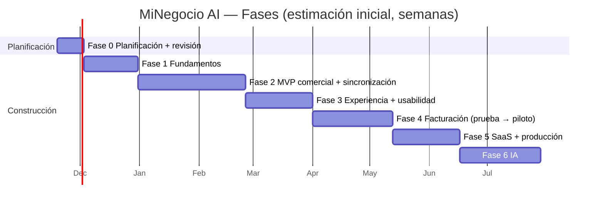

# Roadmap — MiNegocio AI

Versión 0.1 · Fase 0. Las duraciones son **estimaciones para un equipo de 2–3 personas** y se
recalibran al cerrar la Fase 1. Detalle de ítems en [BACKLOG.md](requirements/BACKLOG.md).

| Fase | Objetivo | Criterio de salida (con evidencia) | Riesgos principales |
|---|---|---|---|
| **0 Planificación** | Entregables de diseño revisados | Revisión del responsable del producto (P0-09) y respuestas a Q1–Q8 | Supuestos sin validar con comerciantes |
| **1 Fundamentos** | Monorepo, CI, BD, autenticación, negocios y roles | Registro OTP *fake* → negocio creado sin conexión → sincronizado; prueba de aislamiento en verde; CI ≤ 10 min | Configuración de SQLCipher/Drift; elección del proveedor de OTP |
| **2 MVP comercial** | Productos, compras, inventario, ventas, cobros, fiado, caja y sincronización | Caos 1 000 semillas sin fallos; venta ≤ 300 ms p95 en dispositivo de referencia; piloto interno de 5 días | Complejidad de la sincronización (mayor riesgo técnico) |
| **3 Experiencia** | Onboarding, dashboard, reportes, accesibilidad | Usabilidad: ≥ 7/8 sin ayuda, mediana ≤ 5 min, SUS ≥ 70; reportes conciliados | Carga inicial de productos |
| **4 Facturación** | Comprobantes con proveedor real (pruebas → piloto) | 0 "aceptados" sin evidencia; E2E en staging; piloto de 3–5 negocios con ≥ 98 % aceptados sin intervención; **aprobación explícita** para producción | Normativa (lista P0-11); elección del proveedor; costo por comprobante |
| **5 SaaS** | Planes, panel administrativo, observabilidad, despliegue | Puerta de seguridad aprobada ([THREAT_MODEL](security/THREAT_MODEL.md) §8); restauración verificada; carga simulada | Privacidad y región de datos |
| **6 IA** | Foto de comprobante, voz, asistente, reposición | Precisión ≥ meta en el conjunto de evaluación; 0 escrituras sin confirmación; costo por operación dentro del margen del plan | Costo y precisión con fotos de baja calidad |

## Hitos de decisión (go/no-go)

1. **Fin de Fase 0**: ¿el diseño responde a lo que necesita el comerciante? (entrevistas P0-12).
2. **Fin de Fase 2**: ¿la sincronización es confiable? Sin esto no se avanza a facturación.
3. **Antes de producción de facturación (F4-10)**: validación tributaria completa + aprobación explícita.
4. **Antes de cobrar suscripciones (Fase 5)**: precios validados con el piloto y puerta de seguridad aprobada.
