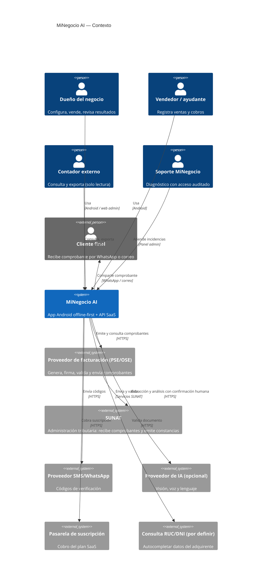
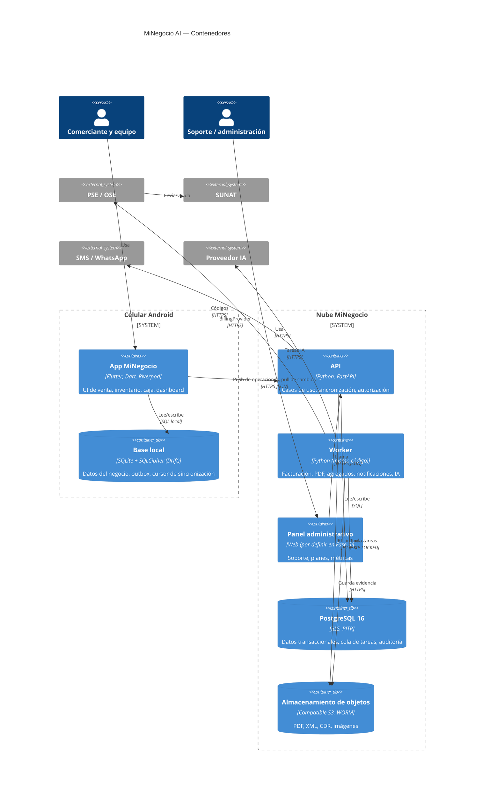
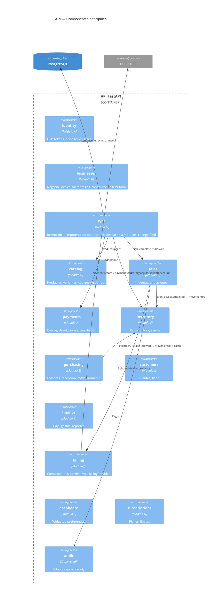
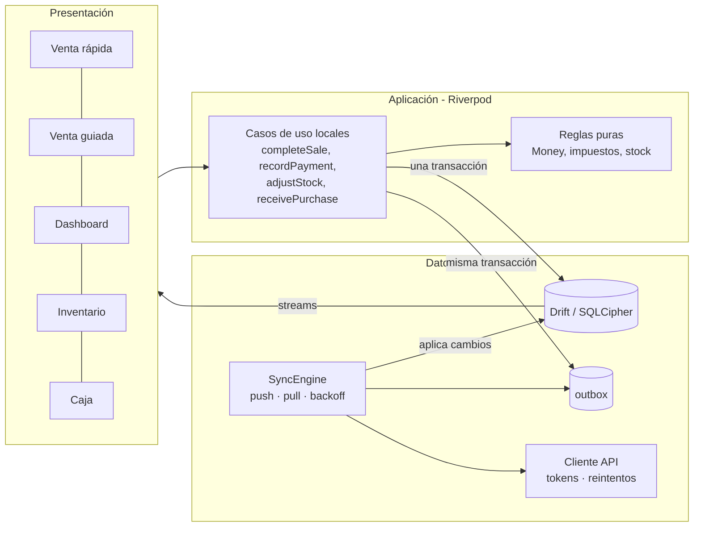

# Modelo C4 — MiNegocio AI

Notación C4 con Mermaid (GitHub la renderiza). Versión 0.1, Fase 0.

## Nivel 1 — Contexto del sistema

## Nivel 2 — Contenedores

## Nivel 3 — Componentes de la API

## Nivel 3 — Componentes de la app

## Nivel 4 — Código

Se documentará en Fase 1–2 con el código real (estructura descrita en
[SYSTEM_ARCHITECTURE.md](SYSTEM_ARCHITECTURE.md) §3.1 y §4.1).
