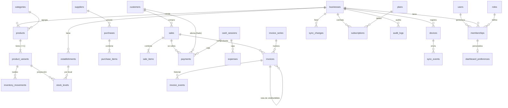

# Diseño de base de datos — MiNegocio AI

Versión 0.1 · Fase 0

- **Fuente ejecutable**: [`db/phase0/schema_draft.sql`](../../db/phase0/schema_draft.sql) (PostgreSQL 16+).
- **Pruebas**: [`db/phase0/schema_checks.sql`](../../db/phase0/schema_checks.sql), con 41 aserciones
  ejecutadas con `tools/check_schema.sh`. Resultado en [PROGRESS.md](../PROGRESS.md).
- En Fase 1 este borrador se traduce a modelos SQLAlchemy 2 y migraciones Alembic. El SQL borrador
  se conserva como especificación y las mismas aserciones se portan a pytest.

## 1. Principios

| # | Principio | Implementación |
|---|---|---|
| 1 | Multiempresa por fila | Toda tabla de negocio tiene `business_id NOT NULL` |
| 2 | Sin referencias cruzadas entre negocios | `UNIQUE (business_id, id)` en cada tabla y **FK compuestas** `(business_id, x_id)` (pruebas T01, T02) |
| 3 | Aislamiento como segunda barrera | RLS `FORCE` con `app.business_id` por transacción (T36–T40) |
| 4 | Identificadores generables sin conexión | `uuid` (v7, ordenable por tiempo) generado en el dispositivo |
| 5 | Dinero exacto | `numeric(14,2)` importes · `numeric(14,4)` precios y costos unitarios · `numeric(14,3)` cantidades ([ADR-003](../decisions/ADR-003.md)) |
| 6 | Hechos financieros inmutables | Ventas, líneas, cobros, kardex, comprobantes y auditoría no admiten `DELETE`; cambios solo por transición de estado permitida + compensación (T09–T20, T31–T35) |
| 7 | Idempotencia en dos niveles | Transporte: `sync_events.op_id` PK. Dominio: índices únicos naturales, como `inv_mov_source_uq` y `(device_id, local_number)` (T08, T22–T24) |
| 8 | Reglas críticas también en la BD | Cuadre de totales (T05–T07), "aceptado sólo con evidencia" (T26), bloqueo de producción (T27) |
| 9 | Estados como `text + CHECK` | Migraciones más simples que `ENUM`; los valores se documentan aquí |
| 10 | Borrado lógico para catálogos | `archived_at` en productos, clientes, proveedores y categorías; los índices únicos son parciales `WHERE archived_at IS NULL` |

## 2. Diagrama entidad-relación (núcleo)

## 3. Catálogo de tablas

Las 22 tablas mínimas que pide el prompt maestro, más 7 de soporte: `categories`, `devices`,
`stock_levels`, `cash_sessions`, `invoice_series`, `sync_changes` y `plans`.

| Tabla | Propósito | Claves y restricciones destacadas | Borrado |
|---|---|---|---|
| `users` | Persona que inicia sesión | Celular E.164 único (parcial); correo único por `lower()` | Lógico (`deleted_at`) + anonimización |
| `roles` | Rol con permisos (`text[]`) | `UNIQUE NULLS NOT DISTINCT (business_id, code)`; roles del sistema con `business_id NULL` | RESTRICT |
| `businesses` | Negocio (tenant) | RUC con formato y único entre negocios no cerrados; régimen tributario; `allow_negative_stock` | Nunca físico; `status='closed'` |
| `establishments` | Local / punto de venta | Un solo `is_main` por negocio; código de anexo SUNAT (validar) | Archivado |
| `memberships` | Usuario ↔ negocio ↔ rol | `UNIQUE (business_id, user_id)`; ámbito opcional por local; `pin_hash` | `status='revoked'` |
| `devices` | Celular registrado | `device_code` 1–999 único por negocio (prefijo de numeración local); `status` | `revoked` |
| `categories` | Agrupación de productos | Nombre único por negocio (parcial); jerarquía con FK compuesta | Archivado |
| `products` | Producto comercial | Unidad y afectación IGV (catálogos SUNAT, validar); `is_favorite` | Archivado |
| `product_variants` | Presentación vendible (talla, sabor, tamaño) | ≥ 1 por producto, una `is_default`; código de barras y SKU únicos por negocio (parciales) | Archivado |
| `suppliers` | Proveedor | Validación de RUC/DNI | Archivado |
| `purchases` / `purchase_items` | Compra recibida | Anulación exige fecha y motivo | RESTRICT; anulación compensatoria |
| `inventory_movements` | **Kardex** append-only | Cantidad con signo ≠ 0; motivo obligatorio en ajustes; índice único por línea de origen | Prohibido (trigger) |
| `stock_levels` | Proyección de stock por local y variante | Actualizada por trigger en la misma transacción; puede ser negativa | Derivada |
| `customers` | Cliente | Documento único por negocio (parcial); límite de crédito opcional | Archivado |
| `cash_sessions` | Apertura y cierre de caja | Una sola caja abierta por dispositivo; cierre exige conteo | RESTRICT |
| `sales` / `sale_items` | Venta completada | `subtotal + tax_total = total`; Σ líneas = cabecera (trigger diferido); número local único por dispositivo; solo `completed → voided` | Prohibido |
| `payments` | Cobro o devolución | Importe > 0; asociado a venta o cliente; inmutable salvo anulación/conciliación | Prohibido |
| `expenses` | Gasto | Categoría, método, caja | Anulación con motivo |
| `invoice_series` | Serie y correlativo | Único por `(negocio, entorno, tipo, serie)`; prefijo F/B (validar) | RESTRICT |
| `invoices` | Comprobante electrónico | Único por `(negocio, entorno, tipo, serie, número)`; aceptado solo con evidencia; factura exige RUC; NC/ND exige referencia; un vigente por venta | Prohibido |
| `invoice_events` | Historial de estados y respuestas | Append-only; respuesta cruda en objetos | Prohibido |
| `dashboard_preferences` | Layout de widgets | Uno por membresía y uno por defecto del negocio | CASCADE con la membresía |
| `sync_events` | Bandeja idempotente de operaciones recibidas | PK `op_id`; `UNIQUE (device_id, device_seq)`; hash del contenido | Retención (§8) |
| `sync_changes` | Feed de cambios para pull incremental | `seq` identidad; append-only | Compactación (§8) |
| `plans` / `subscriptions` | Plan SaaS y suscripción | Una suscripción viva por negocio | RESTRICT |
| `audit_logs` | Auditoría | Append-only; antes/después en `jsonb` | Prohibido; retención (§8) |

## 4. Reglas de dinero e impuestos

Detalle en [ADR-003](../decisions/ADR-003.md). Resumen:

1. **Precio al público con impuestos incluidos** (`sale_price`, `unit_price`), que es como piensa
   el comerciante.
2. Por línea:
   - `line_total = round(quantity × unit_price, 2) − discount` (restricción de BD).
   - `line_subtotal = round(line_total / (1 + tax_rate), 2)` (HALF_UP).
   - `line_tax = line_total − line_subtotal`. Así, valor + impuesto suma exacto por construcción.
3. Cabecera = suma de líneas (trigger diferido `check_sale_totals`).
4. `tax_rate` y `igv_affectation_code` se **copian en la línea**: un cambio de tasa no altera
   ventas pasadas.
5. **Las tasas no se codifican en el código**: se leen de una tabla versionada de reglas
   tributarias por fecha y régimen (Fase 2), porque existen tasas especiales y cambios por ley.
   Ver [INTEGRATION_PLAN](../sunat/INTEGRATION_PLAN.md) §2.4.
6. El redondeo por línea y la forma de expresar totales en el comprobante deben **validarse contra
   las reglas de validación vigentes de SUNAT**. Si difieren, el comprobante se calcula con su propio
   algoritmo a partir de las líneas, sin alterar la venta registrada. *Pendiente de validación.*
7. Ejemplo verificado (T03): 4 × S/ 2,50 = S/ 10,00 → valor S/ 8,47 + IGV S/ 1,53.

## 5. Inventario

- **Kardex append-only** (`inventory_movements`): única forma de cambiar stock. `stock_levels` es
  una proyección que se recalcula desde el kardex si hace falta.
- Tipos: `initial`, `purchase_receipt`, `purchase_void`, `sale`, `sale_void`, `adjustment`,
  `count`, `transfer_out`, `transfer_in`, `customer_return`.
- **Idempotencia de dominio**: `inv_mov_source_uq (source_type, source_id, movement_type)` impide
  descontar dos veces la misma línea de venta o compra aunque la operación llegue dos veces por
  caminos distintos (T08).
- **IDs deterministas**: el movimiento de una línea de venta usa
  `uuid5(namespace, sale_item_id + ':sale')`, de modo que el dispositivo y el servidor generan el
  mismo id y no hay duplicados al sincronizar.
- **Stock negativo permitido por defecto** (`businesses.allow_negative_stock`): dos celulares sin
  conexión pueden vender la última unidad. Rechazar una venta ya entregada al cliente sería peor que
  mostrar una alerta "stock negativo: revisar" (T04).
- **Costo promedio ponderado** en `product_variants.avg_cost`, recalculado al recibir compras; la
  venta guarda `unit_cost_snapshot` para el costo de lo vendido.

## 6. Esquema en el dispositivo (SQLite / Drift)

El dispositivo replica el subconjunto del negocio activo con tipos adaptados:

| Concepto | PostgreSQL | SQLite (Drift) |
|---|---|---|
| uuid | `uuid` | `TEXT` (36) |
| Dinero | `numeric(14,2)` | `INTEGER` en céntimos (`total_cents`) |
| Precio/costo unitario | `numeric(14,4)` | `INTEGER` escala 4 (`unit_price_e4`) |
| Cantidad | `numeric(14,3)` | `INTEGER` escala 3 (`qty_e3`) |
| Fechas | `timestamptz` | `INTEGER` epoch ms UTC |
| jsonb | `jsonb` | `TEXT` JSON |

En Dart se usa el paquete `decimal` para aritmética y la conversión a enteros escalados se hace solo
en la capa de persistencia. En la API el dinero viaja como **cadena decimal** (`"10.00"`), nunca como
número JSON.

Tablas exclusivas del dispositivo:

| Tabla | Uso |
|---|---|
| `outbox` | Operaciones pendientes: `op_id`, `device_seq`, `op_type`, `payload`, `status` (`pending`/`sending`/`acked`/`rejected`), `attempts`, `next_attempt_at`, `last_error` |
| `sync_state` | Cursor de pull (`last_seq`), última sincronización y desfase de reloj |
| `pending_conflicts` | Operaciones rechazadas o en revisión que el usuario debe ver |
| `sale_drafts` | Carritos en curso (no se sincronizan) |
| `local_counters` | Último número local de venta del dispositivo (`D003-000124`) |

## 7. Índices

Además de PK, FK y únicos de la §3:

| Índice | Consulta que atiende |
|---|---|
| `sales (business_id, occurred_at DESC)` | Ventas del día y reportes por periodo |
| `inventory_movements (business_id, variant_id, occurred_at)` | Kardex de un producto |
| `payments (business_id, customer_id)` parcial | Saldo de fiado por cliente |
| `invoices (next_attempt_at)` parcial por estados pendientes | Worker de reintentos de facturación |
| `sync_changes (business_id, seq)` | Pull incremental |
| `sync_events (business_id) WHERE status <> 'applied'` | Bandeja de "requiere atención" |
| `products (business_id, lower(name))` parcial | Búsqueda por nombre (en Fase 2 se evalúa `pg_trgm`) |

Las **FK compuestas** generan índices implícitos solo en la tabla referenciada; en Fase 1 se añadirán
índices en columnas FK de alto uso tras medir con `EXPLAIN ANALYZE` sobre datos sintéticos.

## 8. Retención y eliminación

| Dato | Retención propuesta | Base |
|---|---|---|
| Ventas, cobros, compras, gastos, kardex, comprobantes, evidencia tributaria | Mientras exista el negocio + el plazo legal de conservación | Obligaciones tributarias de conservación de libros y comprobantes. **Plazo exacto pendiente de validación** con asesor tributario |
| `audit_logs` | Igual que los registros financieros a los que se refieren | Trazabilidad |
| `sync_events` | 180 días con contenido completo; después solo `op_id`, estado y hash | Idempotencia de reenvíos tardíos + minimización |
| `sync_changes` | Compactación: se conserva el último cambio por entidad tras 90 días | Pull incremental; un dispositivo con cursor más antiguo hace resincronización completa |
| Datos personales de clientes finales | Hasta que el negocio los elimine o cierre su cuenta, salvo que estén en comprobantes emitidos | Ley N.° 29733 + obligación tributaria |
| Cuenta de usuario eliminada | Anonimización de `users` (nombre, celular, correo); las referencias en registros financieros se conservan | Derecho de supresión equilibrado con obligación legal |

## 9. Mecanismos contra duplicados y pérdida de datos (resumen)

Detalle en [SYNC_STRATEGY.md](SYNC_STRATEGY.md).

1. `op_id` único por operación. Un reenvío devuelve el resultado guardado y no se aplica de nuevo.
2. `device_seq` monótono por dispositivo, que detecta huecos (operaciones perdidas) y reordenamientos.
3. `payload_hash`: el mismo `op_id` con distinto contenido se rechaza como conflicto de integridad.
4. Ids de entidad generados en el cliente: crear dos veces la misma venta choca con la PK.
5. Claves naturales únicas: `(device_id, local_number)`, `inv_mov_source_uq`, comprobante único por
   serie y número, un comprobante vigente por venta.
6. Outbox local en la **misma transacción** que el dato: si la app muere, la operación existe o no
   existe completa.
7. Respaldo local opcional cifrado (exportación manual) y aviso cuando hay operaciones sin
   sincronizar por más de 24 h.
