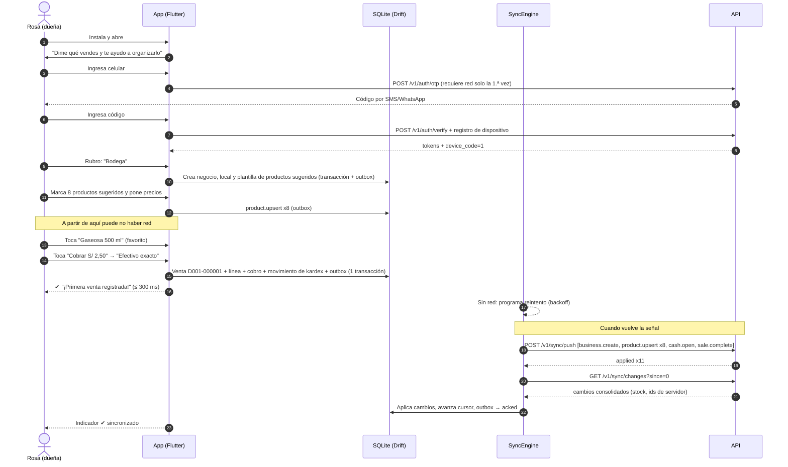
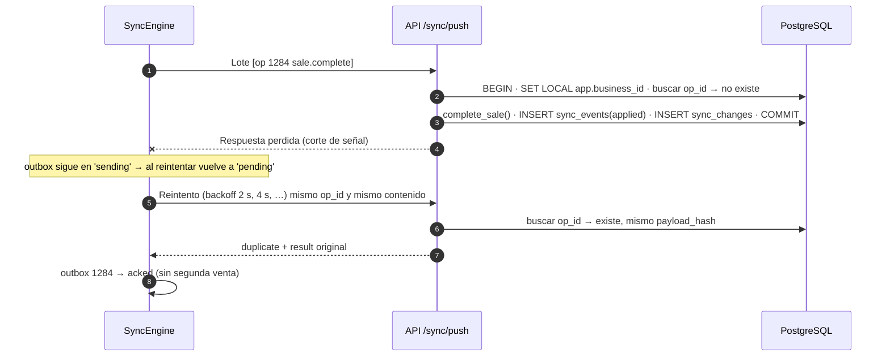
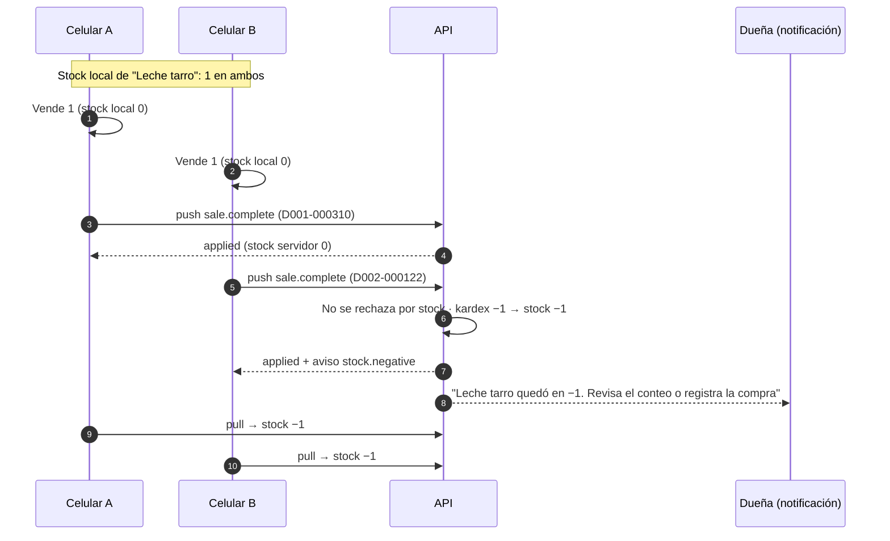
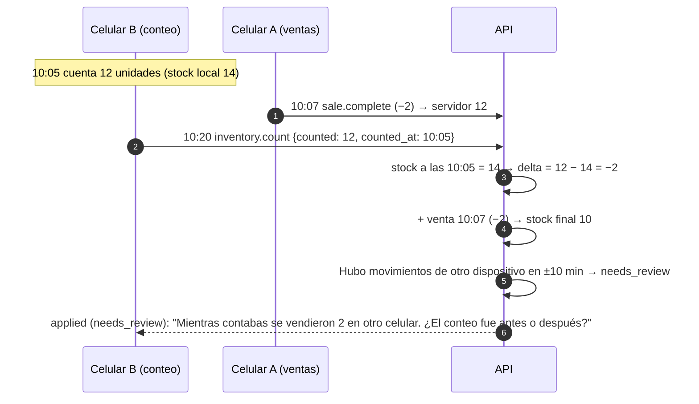
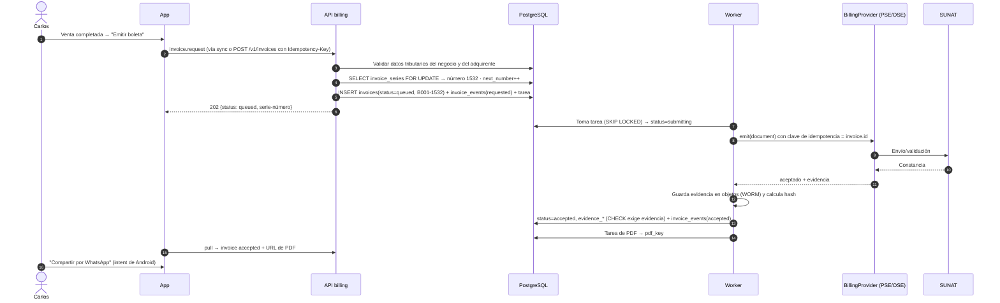
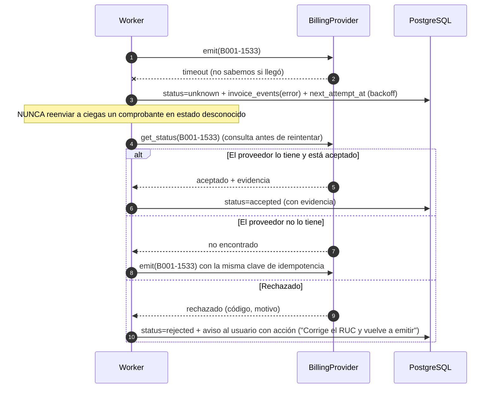
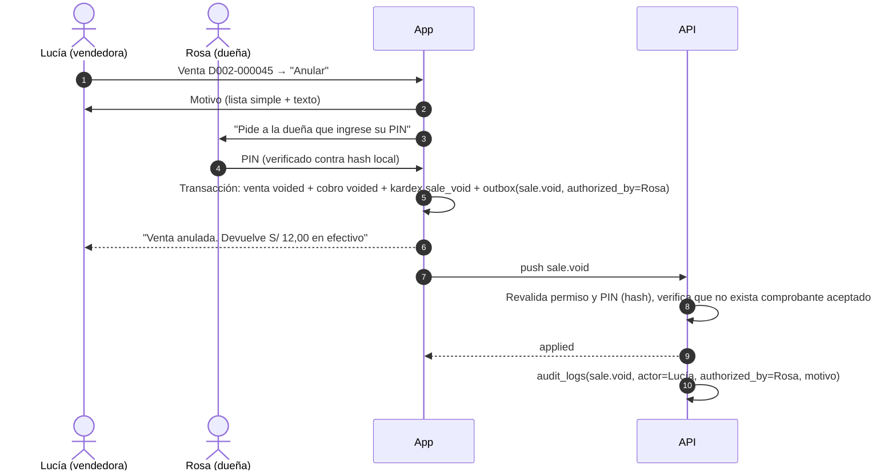
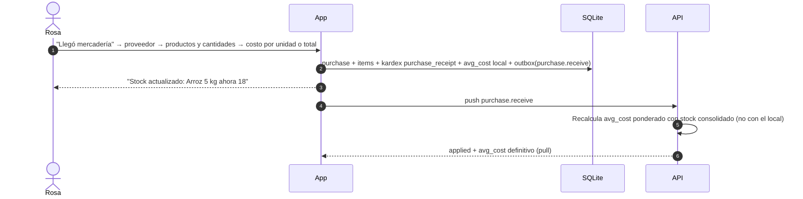

# Diagramas de secuencia — MiNegocio AI

Versión 0.1 · Fase 0

## 1. Primera venta (onboarding → venta rápida, sin conexión)

## 2. Push idempotente con respuesta perdida

## 3. Dos dispositivos sin conexión venden la última unidad

## 4. Conteo físico concurrente con ventas

## 5. Emisión de boleta electrónica (con conexión)

## 6. Emisión con proveedor caído o respuesta ambigua

## 7. Anulación de venta por vendedor (sin conexión, con PIN)

## 8. Recepción de compra con costo promedio

