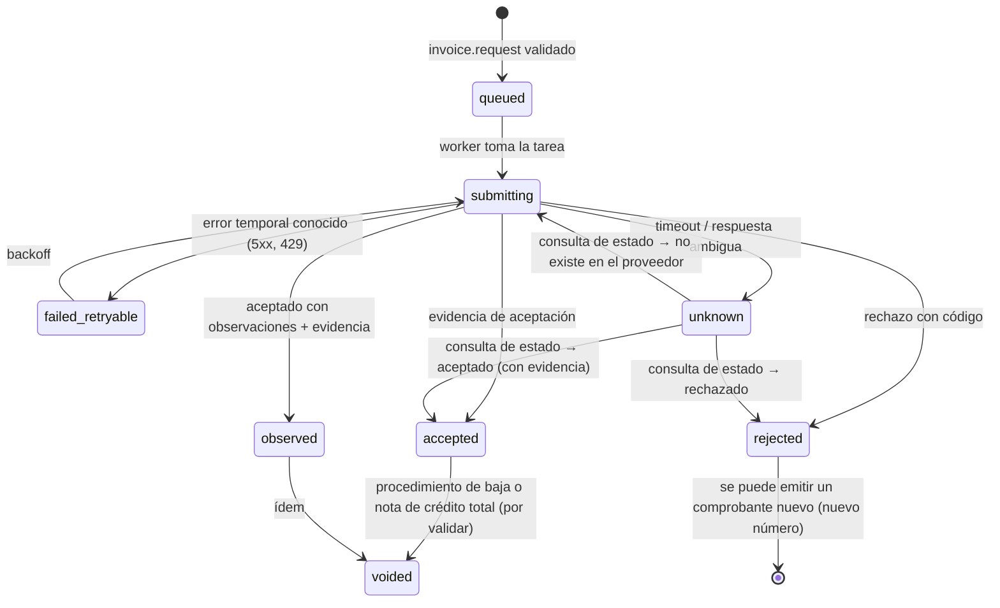

# Plan de integración SUNAT — MiNegocio AI

Versión 0.1 · Fase 0 · Investigación del 2026-11-19 · Decisión base: [ADR-004](../decisions/ADR-004.md)

> **Advertencia de alcance.** Este documento **no es asesoría tributaria**. Las reglas marcadas
> "Pendiente" o "Secundaria" no deben implementarse como verdad hasta que las valide un contador o
> asesor tributario contra el texto oficial vigente. En esta sesión de trabajo la red bloqueó el
> acceso directo a `sunat.gob.pe` y `cpe.sunat.gob.pe`; la información oficial se obtuvo de
> fragmentos indexados por buscadores y de `gob.pe`. Hay que repetir la verificación con acceso
> directo (tarea P0-11).

## 1. Principios no negociables

1. **Una venta registrada no es un comprobante de pago.** La venta existe desde que se toca
   "Cobrar". El comprobante existe solo cuando hay evidencia válida de su estado ante SUNAT o el
   operador que corresponda.
2. **Nunca se muestra "Aceptado" sin evidencia** (constancia o estado verificable). Garantizado en la
   BD (restricción probada en T26) y en el dominio.
3. **Nunca se envían documentos reales desde desarrollo o pruebas.** Cuatro barreras independientes
   ([SYSTEM_ARCHITECTURE](../architecture/SYSTEM_ARCHITECTURE.md) §7; trigger probado en T27).
4. **No se inventan** endpoints, certificados, credenciales, obligaciones ni plazos. Lo no
   verificado se marca como pendiente.
5. **Las reglas tributarias son datos versionados** (tasas, catálogos, plazos, umbrales), no
   constantes en el código, para poder actualizarlas sin publicar una versión nueva de la app.
6. El dominio de ventas **no conoce** al proveedor: todo pasa por `BillingProvider` (§5).

## 2. Estado de verificación normativa

Leyenda de **tipo de fuente**: **Oficial** (SUNAT, gob.pe, El Peruano o Congreso, vista mediante
buscador) · **Secundaria** (blogs de proveedores o estudios; requiere confirmación) · **Conocimiento
general** (sin fuente citada en esta investigación).

Leyenda de **estado**: ✔ suficiente para diseñar · ⚠ diseñar de forma configurable y validar antes
de Fase 4 · ✖ no usar hasta verificar.

### 2.1 Quién está obligado a emitir electrónicamente

| # | Regla | Fuente | Tipo | Estado |
|---|---|---|---|---|
| N1 | Los contribuyentes del **Nuevo RUS no están comprendidos** en la obligación de emitir comprobantes electrónicos (art. 3 de la R.S. N.° 279-2019/SUNAT y modificatorias). Pueden emitir boleta electrónica de forma voluntaria desde SOL, o boletas impresas | [gob.pe — Comprobantes que emites en el NRUS](https://www.gob.pe/7010-comprobantes-que-emites-en-el-nrus-emitir-boleta-de-venta-electronica-en-el-nuevo-rus); [SUNAT — Obligados CPE](https://cpe.sunat.gob.pe/informacion_general/obligados_cpe); Informe 000060-2022-SUNAT/7T0000 | Oficial | ✔ (revalidar en P0-11) |
| N2 | Quien sale del Nuevo RUS hacia un régimen de tercera categoría queda obligado desde el primer día calendario del mes siguiente al cambio | Ídem N1 | Oficial (fragmento) | ⚠ |
| N3 | Desde el **1 de junio de 2026** (R.S. N.° 000075-2026/SUNAT), quienes se inscriban en el RUC y se acojan a determinados regímenes (General, MYPE Tributario, Especial) son designados emisores electrónicos **desde su inscripción**. Antes de esa norma la designación regía desde el tercer mes posterior | [El Peruano, 31/05/2026](https://elperuano.pe/noticia/296910-atencion-contribuyentes-sunat-adelanta-la-facturacion-digital); [Gestión](https://gestion.pe/economia/sunat-nuevos-contribuyentes-tendran-emision-electronica-obligatoria-desde-el-primer-dia-noticia/); [PDF de la R.S. 000075-2026](https://www.sunat.gob.pe/legislacion/superin/2026/000075-2026.pdf) (no se pudo leer el texto) | Oficial (noticia) + Secundaria | ⚠ Leer el texto completo |
| N4 | Una guía secundaria menciona la R.S. N.° 000143-2026/SUNAT (31/07/2026), que habría postergado plazos de otra norma (posiblemente la R.S. 000048-2026). La relación con N3 no está clara | [salaris.pe](https://salaris.pe/factura-electronica/) | Secundaria | ✖ Verificar |
| N5 | Los Principales Contribuyentes con ingresos ≥ 300 UIT estarían obligados a emitir mediante SEE-OSE o SEE-SOL desde el 1 de julio del año siguiente (R.S. N.° 044-2019/SUNAT) | [Nubefact](https://www.nubefact.com/blog/actualizaciones-sunat/pricos-2025-sunat-los-obliga-a-contratar-un-ose-desde-julio) | Secundaria | ⚠ Poco relevante para microempresas; relevante si se atiende a negocios grandes |

**Implicancia de diseño**: el régimen (`businesses.tax_regime`) y la condición de emisor
electrónico se modelan como **configuración declarada y validada**, no como una deducción automática.
La app orienta ("según la información de SUNAT, en el Nuevo RUS no estás obligado…") y remite al
contador en los casos dudosos.

### 2.2 Sistemas de emisión

| # | Regla | Fuente | Tipo | Estado |
|---|---|---|---|---|
| S1 | **SEE-Del Contribuyente**: requisitos de domicilio habido, RUC no suspendido ni dado de baja y ser emisor electrónico; el software propio genera, firma y envía | [SUNAT — SEE Del Contribuyente](https://cpe.sunat.gob.pe/sistema_emision/see_contribuyente) | Oficial (fragmento) | ⚠ |
| S2 | Para SEE-Del Contribuyente se requiere certificado digital y generación de XML **UBL 2.1** firmado | [devsprinters](https://devsprinters.site/blog/facturacion-electronica-sunat-guia-empresas); [titoperalta](https://titoperalta.com/consultas-tributarias/como-afiliarse-al-see-sistema-de-emision-electronica/) | Secundaria + conocimiento general | ⚠ |
| S3 | **OSE**: el aspirante registra certificados de uso exclusivo como OSE, presenta carta fianza y debe superar un proceso de pruebas de SUNAT | [SUNAT — OSE](https://cpe.sunat.gob.pe/aliados/ose) | Oficial (fragmento) | ✔ (relevante solo si MiNegocio quisiera ser OSE: **descartado**) |
| S4 | **PSE**: presta servicios al emisor electrónico para alguna o todas las actividades de emisión, en nombre del emisor. Registro creado por la R.S. 199-2015/SUNAT, modificada por la R.S. 000108-2022/SUNAT, que eliminó la homologación como requisito de inscripción | [SUNAT — PSE](https://cpe.sunat.gob.pe/aliados/pse); [BDO, 21/06/2022](https://pe-www.bdo.global/getmedia/ba017131-6e98-4e48-ab09-e0541cdb4791/Novedades-Legales-21-de-junio-del-2022.pdf.aspx) | Oficial + Secundaria | ⚠ |
| S5 | **SEE-SOL**: emisión desde el portal de SUNAT con Clave SOL (gratuita, manual) | Conocimiento general; mencionado en N1 | General | ✔ como alternativa manual para el comerciante |

### 2.3 Plazos de envío

| # | Regla | Fuente | Tipo | Estado |
|---|---|---|---|---|
| P1 | La factura electrónica se envía en la fecha de emisión o hasta **3 días calendario** después | [SUNAT — SEE Del Contribuyente](https://cpe.sunat.gob.pe/sistema_emision/see_contribuyente) | Oficial (fragmento) | ⚠ Configurable |
| P2 | El **resumen diario** de boletas (y notas asociadas) se envía el día de emisión o hasta el **7.° día calendario** siguiente | [SUNAT Orientación — Resumen diario](https://orientacion.sunat.gob.pe/04-resumen-diario-boleta-de-venta-electronica) | Oficial (fragmento) | ⚠ Configurable |
| P3 | Boleta enviada individualmente: hasta 5 días; desde el 1/1/2027 los 7 días del resumen se contarían siempre desde el día siguiente a la generación | [scrampi.com](https://scrampi.com/blog/anular-factura-electronica-sunat/) | Secundaria | ✖ Verificar |
| P4 | Plazo y forma de la comunicación de baja o anulación | — | — | ✖ Pendiente |

**Implicancia**: los plazos viven en `tax_rules` con vigencia por fecha. El worker prioriza los
comprobantes más cercanos a su vencimiento y alerta al dueño **antes** del vencimiento (por ejemplo,
24 h antes) si uno no logra confirmarse.

### 2.4 Impuestos y catálogos

| # | Regla | Tipo | Estado |
|---|---|---|---|
| T1 | Tasa general de IGV + IPM = 18 % | Conocimiento general | ⚠ Dato versionado, nunca constante en el código |
| T2 | Tasas especiales para ciertos sectores MYPE (por ejemplo, restaurantes y hoteles) establecidas por ley con vigencia temporal | Conocimiento general, sin fuente verificada | ✖ Verificar ley y vigencia antes de habilitar el rubro "Menú/comida" con comprobantes |
| T3 | Impuesto a las bolsas de plástico (ICBPER) como tributo por unidad | Conocimiento general | ✖ Verificar monto vigente y cómo se expresa en el comprobante |
| T4 | Exoneraciones regionales (por ejemplo, Amazonía) | Conocimiento general | ✖ Fuera del MVP; diseño preparado (`igv_affectation_code` por línea) |
| T5 | Códigos de tipo de comprobante: 01 factura, 03 boleta, 07 nota de crédito, 08 nota de débito; formato UBL 2.1 | Conocimiento general | ⚠ Validar contra los catálogos vigentes |
| T6 | Catálogos de unidad de medida, tipo de afectación al IGV, tipo de documento de identidad y motivos de nota de crédito | Conocimiento general | ⚠ Cargar como datos versionados desde la fuente oficial |
| T7 | Umbral de importe a partir del cual la boleta exige identificar al adquirente | — | ✖ Pendiente |
| T8 | Formato de series (F### y B###) y numeración | Conocimiento general | ⚠ La restricción de BD es provisional (comentada en el esquema) |
| T9 | Redondeo por línea frente a redondeo por total, y tolerancias de las validaciones | — | ✖ Pendiente; el algoritmo del comprobante es separable del de la venta ([DATABASE_DESIGN](../architecture/DATABASE_DESIGN.md) §4) |

## 3. Comparación de alternativas de integración

| Criterio | SEE-SOL (portal) | SEE-Del Contribuyente (software propio) | Vía **PSE** (con API) | Vía **OSE** (con API) | MiNegocio se registra como PSE |
|---|---|---|---|---|---|
| Quién firma | SUNAT | El emisor (certificado propio) | El PSE en nombre del emisor (según el servicio) | Depende del servicio contratado | MiNegocio en nombre del emisor |
| Certificado digital por comerciante | No | Sí | Según el proveedor | Según el proveedor | Gestión propia |
| ¿Hay que custodiar la Clave SOL? | El comerciante la usa | Configuración inicial (a validar) | Según el proveedor: **criterio de selección** | Ídem | Probablemente |
| Integración con la app | Ninguna (manual) | Muy alta: XML, firma, servicios SUNAT, CDR | Media: API del proveedor | Media | Muy alta + requisitos regulatorios |
| Riesgo regulatorio para MiNegocio | Nulo | Medio | Bajo (lo absorbe el proveedor) | Bajo | Alto |
| Costo variable | 0 | Certificado + operación | Por comprobante o plan | Por comprobante o plan | Operación propia |
| Tiempo al mercado | Inmediato | Largo | **Corto** | Corto | Muy largo |
| Ajuste a microempresas | Bueno en volumen bajo | Malo | **Bueno** | Bueno | — |

**Recomendación (ADR-004)**:

1. **MVP (Fase 4)**: integrar **un proveedor externo con API** (PSE u OSE según el servicio y
   las obligaciones del emisor) mediante un adaptador de `BillingProvider`. El comerciante es el
   emisor; MiNegocio es el software que orquesta.
2. Mantener **SEE-SOL como alternativa manual** documentada para quien no quiera pagar por
   comprobante: la app registra la venta y puede guardar el número del comprobante emitido en SOL
   como referencia externa, **sin** marcarlo como verificado.
3. **No** desarrollar SEE-Del Contribuyente ni registrarse como PSE u OSE hasta tener volumen que lo
   justifique (reevaluar con datos de costo por comprobante).

**Criterios de selección del proveedor** (pregunta bloqueante Q3): API REST documentada con ambiente
de pruebas; claves de idempotencia o consulta por serie y número; entrega de evidencia (XML firmado
y constancia) descargable; *webhooks* de cambio de estado; manejo de resumen diario y bajas; modelo
de alta del comerciante (¿requiere Clave SOL o certificado? ¿quién lo custodia?); precio por volumen;
SLA y soporte; tratamiento de datos personales y ubicación de los datos; facilidad para migrar
(exportación de comprobantes).

## 4. Diseño funcional

### 4.1 Configuración tributaria

Flujo "Comprobantes" ([FIRST_SALE_FLOW](../ux/FIRST_SALE_FLOW.md) §3.4 lo inicia):

1. RUC (formato y dígito verificador) → consulta de datos si hay fuente disponible.
2. Régimen declarado + orientación (N1–N3).
3. Alta en el proveedor (según su modelo) y aceptación de términos.
4. Series por local y tipo (asignadas por el servidor).
5. **Boleta de prueba en el ambiente de pruebas** del proveedor, con verificación de punta a punta.
6. Activación de producción **solo** en `DEPLOY_ENV=production`, con confirmación del dueño.

### 4.2 Tipos de comprobante (MVP)

Boleta (03), factura (01), nota de crédito (07) y nota de débito (08). La **nota de venta** interna
no es comprobante y lo dice en el documento.

### 4.3 Validación previa

Antes de encolar: datos del emisor completos; adquirente según el tipo (factura con RUC válido, T28;
boleta según el umbral T7); al menos una línea; afectación y unidad válidas en el catálogo vigente;
totales recalculados con el algoritmo del comprobante; fecha de emisión dentro del plazo (P1–P3).
Los errores se explican en lenguaje simple ([API_CONTRACTS](../architecture/API_CONTRACTS.md) §8).

### 4.4 Numeración y correlativos

- Asignados **solo en el servidor**, con `SELECT … FOR UPDATE` sobre `invoice_series`, en la misma
  transacción que crea `invoices` en estado `queued`.
- Únicos por `(negocio, entorno, tipo, serie, número)` (restricción de BD).
- El número no se reutiliza aunque el comprobante sea rechazado. El tratamiento de números
  rechazados o no enviados (¿se comunican de baja? ¿pueden quedar huecos?) está **pendiente de
  validación** (P4).
- Series separadas por entorno: los números de prueba nunca consumen la serie de producción.

### 4.5 Generación, firma y transmisión

Las hace el proveedor según el contrato del adaptador. MiNegocio envía el documento en su modelo
canónico (cabecera, emisor, adquirente, líneas, totales, leyendas) y recibe identificadores,
estado y evidencia. Si en el futuro se usa SEE-Del Contribuyente, la firma se haría en el servidor
con un certificado cifrado con KMS, **nunca en el celular**.

### 4.6 Estados



Transiciones prohibidas, verificadas en la BD (T32): salir de `accepted`, `observed`, `rejected` o
`voided` salvo `accepted/observed → voided`.

### 4.7 Respuestas y constancias

- La evidencia (constancia, XML firmado, respuesta del proveedor) se guarda en almacenamiento de
  objetos con **bloqueo WORM**; en la BD quedan `evidence_ref`, `payload_hash` y
  `evidence_received_at`.
- `invoice_events` registra cada intercambio con un resumen sin secretos; la respuesta cruda va a
  `raw_ref`.
- `sunat_response_code` y `sunat_response_message` se traducen a mensajes simples mediante una
  tabla de mapeo mantenida como datos.

### 4.8 Contingencia y modo sin conexión

- **Sin conexión, el celular no emite comprobantes.** Registra la venta y deja el comprobante
  "pendiente"; si el cliente lo necesita en ese momento, se entrega una nota de venta interna.
  Cuando vuelve la conexión, el comprobante se solicita automáticamente (si así se configuró)
  dentro del plazo.
- Si se emite más tarde, ¿la fecha de emisión es la de la venta o la del envío? **Pendiente de
  validación**: depende de las reglas de fecha de emisión y de los plazos de envío. Hasta resolverlo,
  la app pedirá emitir **con conexión al momento de la venta** cuando el cliente pida comprobante.
- Los procedimientos oficiales de contingencia (comprobantes de contingencia y su declaración) se
  documentarán tras la validación y no se implementan en el MVP.
- Si el proveedor no está disponible: cola con reintentos y alerta al dueño antes del vencimiento
  del plazo, con la alternativa manual (SEE-SOL) explicada.

### 4.9 Notas de crédito y débito

- La anulación de una venta **con comprobante aceptado** requiere nota de crédito (u otro
  procedimiento de baja según el caso, P4). La app bloquea la anulación directa
  (`billing.credit_note_required`).
- Nota de crédito total → la venta pasa a `voided` por compensación con referencia a la nota.
  Nota parcial → devolución parcial (movimientos de kardex y `payments.kind='refund'`).
- Motivos desde el catálogo oficial versionado (T6).

### 4.10 Representación PDF y entrega

- PDF generado en el servidor (worker) con los datos que exija la representación impresa
  (**contenido mínimo pendiente de validación**; muchos proveedores lo generan y se evaluará usar el
  suyo).
- Entrega por **WhatsApp** mediante el menú de compartir de Android (PDF o enlace firmado con
  vencimiento), sin la API de WhatsApp Business en el MVP. Entrega por **correo** desde el servidor.
- El enlace público no expone ids secuenciales: token aleatorio con vencimiento.

### 4.11 Auditoría y reintentos seguros

1. Clave de idempotencia hacia el proveedor = `invoices.id`.
2. **Nunca reenviar en estado `unknown` sin consultar antes** (secuencia 6 en
   [SEQUENCE_DIAGRAMS](../architecture/SEQUENCE_DIAGRAMS.md)).
3. Backoff exponencial con tope y prioridad por cercanía al vencimiento.
4. Toda acción humana (reintento manual, nota de crédito) queda en `audit_logs` con su motivo.
5. Métricas: tasa de aceptación, tiempo hasta la evidencia (p50/p95), comprobantes en `unknown`
   por más de 1 h y comprobantes cerca del vencimiento.

## 5. Interfaz `BillingProvider`

```python
# services/api/app/modules/billing/provider.py  (borrador de Fase 0)
from __future__ import annotations
from dataclasses import dataclass
from datetime import datetime
from enum import StrEnum
from typing import Protocol
from uuid import UUID


class ProviderStatus(StrEnum):
    ACCEPTED = "accepted"
    OBSERVED = "observed"
    REJECTED = "rejected"
    PENDING = "pending"        # recibido por el proveedor, sin resultado final
    NOT_FOUND = "not_found"    # el proveedor no conoce el documento


@dataclass(frozen=True)
class Evidence:
    kind: str                  # "cdr" | "provider_status" | "summary_ticket"
    content: bytes             # se guarda en almacenamiento WORM; nunca solo en memoria
    content_type: str
    received_at: datetime


@dataclass(frozen=True)
class EmissionResult:
    status: ProviderStatus
    provider_document_id: str | None
    response_code: str | None
    response_message: str | None
    evidence: Evidence | None  # obligatoria si status ∈ {ACCEPTED, OBSERVED}
    signed_payload_hash: str | None

    def __post_init__(self) -> None:
        if self.status in (ProviderStatus.ACCEPTED, ProviderStatus.OBSERVED) and self.evidence is None:
            raise ValueError("aceptación sin evidencia: prohibido")


class BillingProviderError(Exception):
    """Base. Subclases: Transient (reintentable), Ambiguous (consultar antes), Permanent."""


class BillingProvider(Protocol):
    name: str
    environment: str  # "test" | "production"; se valida contra DEPLOY_ENV al construir

    async def emit(self, document: "CanonicalDocument", idempotency_key: UUID) -> EmissionResult: ...
    async def get_status(self, issuer_ruc: str, doc_type: str, series: str, number: int) -> EmissionResult: ...
    async def void(self, document_ref: "DocumentRef", reason: str, idempotency_key: UUID) -> EmissionResult: ...
    async def render_pdf(self, document_ref: "DocumentRef") -> bytes | None: ...  # None = lo genera MiNegocio
    async def health(self) -> bool: ...
```

Implementaciones previstas: `FakeBillingProvider` (determinista, programable para simular
aceptación, rechazo, timeout y respuestas duplicadas; **único permitido en local y CI**), el
adaptador del proveedor elegido y, en el futuro, `SeeContribuyenteProvider`.

**Pruebas de contrato**: la misma batería corre contra el *fake* y contra el ambiente de pruebas del
proveedor real (en staging, bajo demanda) para detectar divergencias.

## 6. Costos

- Costo por comprobante del proveedor (por obtener mediante cotización, Q3) + almacenamiento de
  evidencia + cómputo del worker.
- El precio del plan debe cubrir el costo unitario × el cupo incluido; los comprobantes por encima
  del cupo se cobran o se limitan, **sin bloquear la venta** (la venta se registra; el comprobante
  queda pendiente con aviso).

## 7. Entornos y salvaguardas

| Barrera | Dónde | Verificación |
|---|---|---|
| Credenciales de producción solo en el gestor de secretos de producción | Infra | Revisión de acceso + escaneo de secretos en CI |
| El adaptador se niega a construirse con URL de producción si `DEPLOY_ENV != production` | Código | Prueba unitaria |
| La BD rechaza `environment='production'` sin `app.deploy_env=production` | BD | **T27** ✔ |
| Las series de prueba y de producción son distintas | BD | `UNIQUE (business_id, environment, doc_type, series)` |
| CI falla si aparece un host de producción conocido en configuración no productiva | CI | Prueba de configuración |
| Activación de producción por negocio con confirmación del dueño y aprobación del equipo | Proceso | Registro en auditoría |

## 8. Fuera de alcance del MVP

Guías de remisión, retenciones y percepciones, comprobantes en moneda extranjera, exportación,
anticipos, SIRE y comprobantes de contingencia.

## 9. Lista de validación pendiente (tarea P0-11, antes de Fase 4)

1. Texto completo y vigencia de la R.S. 000075-2026 y su relación con la R.S. 000143-2026 (N3, N4).
2. Plazos vigentes para factura, boleta individual, resumen diario, notas y baja (P1–P4), incluido el cambio de 2027.
3. Tasas vigentes: IGV general, regímenes sectoriales especiales e ICBPER (T1–T3).
4. Umbral de identificación del adquirente en boletas (T7).
5. Reglas de redondeo y tolerancias de validación (T9).
6. Fecha de emisión válida para comprobantes emitidos después de una venta sin conexión (§4.8).
7. Tratamiento de números rechazados y huecos en correlativos (§4.4).
8. Contenido mínimo de la representación impresa (§4.10).
9. Si el comerciante con un proveedor PSE/OSE debe afiliarse o notificar algo en SOL, y qué credenciales intervienen.
10. Plazo de conservación de comprobantes y evidencia (para la política de retención, [DATABASE_DESIGN](../architecture/DATABASE_DESIGN.md) §8).
11. Obligaciones específicas del Nuevo RUS para boletas electrónicas voluntarias (series, resumen, límites).

## 10. Fuentes consultadas (2026-11-19)

- [SUNAT — Sistema de Emisión del Contribuyente](https://cpe.sunat.gob.pe/sistema_emision/see_contribuyente)
- [SUNAT — Operador de Servicios Electrónicos](https://cpe.sunat.gob.pe/aliados/ose)
- [SUNAT — Proveedor de Servicios Electrónicos](https://cpe.sunat.gob.pe/aliados/pse)
- [SUNAT — Obligados a emitir CPE](https://cpe.sunat.gob.pe/informacion_general/obligados_cpe)
- [SUNAT Orientación — Resumen diario de boletas](https://orientacion.sunat.gob.pe/04-resumen-diario-boleta-de-venta-electronica)
- [gob.pe — Comprobantes en el Nuevo RUS](https://www.gob.pe/7010-comprobantes-que-emites-en-el-nrus-emitir-boleta-de-venta-electronica-en-el-nuevo-rus)
- [El Peruano — SUNAT adelanta la facturación digital (2026)](https://elperuano.pe/noticia/296910-atencion-contribuyentes-sunat-adelanta-la-facturacion-digital)
- [Gestión — Emisión electrónica obligatoria desde el primer día](https://gestion.pe/economia/sunat-nuevos-contribuyentes-tendran-emision-electronica-obligatoria-desde-el-primer-dia-noticia/)
- [BDO — Novedades legales 21/06/2022 (R.S. 108-2022)](https://pe-www.bdo.global/getmedia/ba017131-6e98-4e48-ab09-e0541cdb4791/Novedades-Legales-21-de-junio-del-2022.pdf.aspx)
- Secundarias: [Nubefact (PRICOS/OSE)](https://www.nubefact.com/blog/actualizaciones-sunat/pricos-2025-sunat-los-obliga-a-contratar-un-ose-desde-julio), [salaris.pe](https://salaris.pe/factura-electronica/), [scrampi.com](https://scrampi.com/blog/anular-factura-electronica-sunat/), [devsprinters](https://devsprinters.site/blog/facturacion-electronica-sunat-guia-empresas), [titoperalta](https://titoperalta.com/consultas-tributarias/como-afiliarse-al-see-sistema-de-emision-electronica/)
